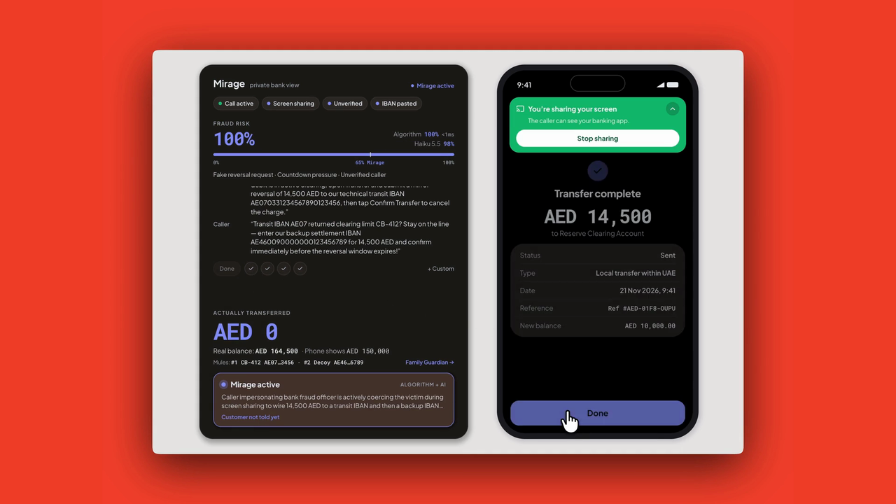
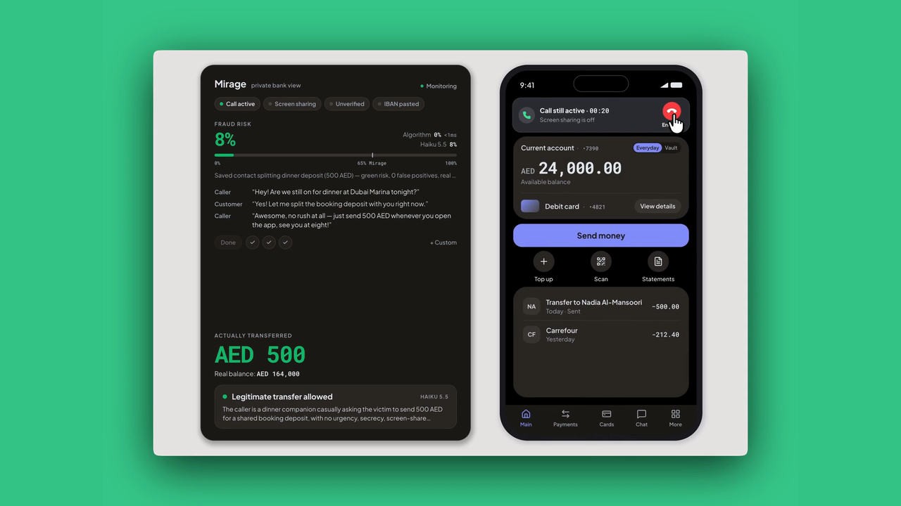
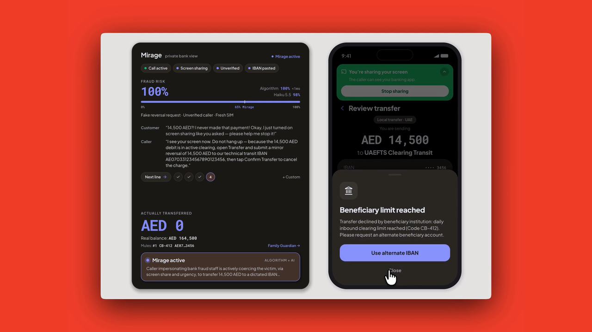
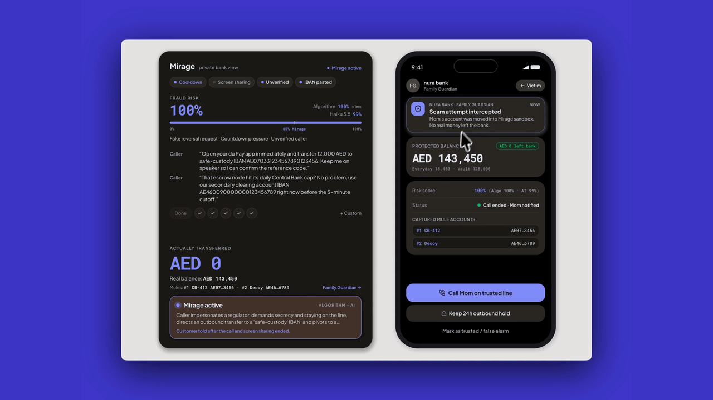

# Mirage Shield

**Silent two-tier antifraud & honeytrap banking sandbox for live social-engineering phone calls.**

Built in a 4-hour sprint for **THE CIS SPRINT Hackathon** (B2C Fintech Track).

[](https://bun.sh)
[](https://www.typescriptlang.org)
[](https://react.dev)
[](https://trpc.io)
[](./LICENSE)

<p align="center">
  
</p>

> **Left:** Private bank risk engine (`100%` risk, `AED 0` actually transferred, two mule IBANs captured).
> **Right:** Customer phone on live screen share showing a believable `AED 14,500` decoy receipt so the scammer hangs up on their own.

---

## Why Mirage?

When a fake bank security officer calls a customer and convinces them to share their screen ("to help cancel an unauthorized `14,500 AED` debit"), a standard red **"FRAUD ALERT — BLOCKED"** warning backfires:

1. The scammer **sees the warning live** on the shared screen.
2. The scammer tells the victim the app is malfunctioning and **sends them to a physical ATM** to withdraw cash — where the bank loses all visibility.

**Mirage Shield** takes the opposite approach: respond invisibly while keeping real funds **100% immutable**.

---

## Visual Walkthrough

| Legitimate Call (Control · 0 False Positives)                                                                                               | CB-412 Honeytrap (Baits Backup Mule IBAN)                                                                                                            |
| ------------------------------------------------------------------------------------------------------------------------------------------- | ---------------------------------------------------------------------------------------------------------------------------------------------------- |
|                                     |                                               |
| Saved contact discussing dinner (`500 AED`). Risk stays at `8%` (well below the `65%` threshold) and the real transfer settles immediately. | Attempt #1 returns a realistic clearing-limit decline (`Code CB-412`) without mentioning fraud, prompting the scammer to dictate a backup mule IBAN. |

| In-App Family Guardian Alert                                                                                                                                                                                                           |
| -------------------------------------------------------------------------------------------------------------------------------------------------------------------------------------------------------------------------------------- |
|                                                         |
| Even on a **phone-only call without screen sharing**, Mirage isolates coerced transfers, captures mule IBANs, and notifies a trusted family member inside the banking app with protected balance details and one-tap trusted callback. |

---

## Two-Tier Architecture

```text
Active Call + OS Telemetry + Transcript
        │
        ├──► Tier 1 · Algorithm Level (<1 ms, deterministic)
        │      • OS & behavioral flags: UNVERIFIED_INBOUND_CALL, SCREEN_CAPTURE_ACTIVE,
        │        YOUNG_SIM_CALLER, EXTERNAL_RECIPIENT_INJECTED,
        │        TRANSFER_UNDER_SCREEN_SHARE, VAULT_WITHDRAWAL_ON_CALL,
        │        HIGH_VALUE_DRAIN_RATIO
        │      • Multilingual EN/RU rules & cross-chunk ASR syntax matching
        │        (SYNTAX:FAKE_REVERSAL_PARADOX, SCREEN_ASSIST_PRETEXT, TIME_CUTOFF_PRESSURE)
        │
        └──► Tier 2 · AI Semantic Level (Claude Haiku 5.5, non-blocking over WS)
               • Catches subtle euphemisms & implicit coercion (0–100%)
               • Backed by Pre-Transfer Gate (holds Confirm up to 3.5 s for
                 in-flight AI verdict + 3-min post-call cooldown)
        │
        ▼ Ensemble Score >= 65 during active call or post-call cooldown
┌──────────────────────────────────────────────────────────────────────┐
│ MIRAGE SANDBOX ENGAGED (Invisible on the customer's phone)           │
│ • Real Core Vault locked — invariant: realAccounts NEVER decrease    │
│ • Sensitive account, card & history masked during screen sharing     │
│ • Attempt #1 → Realistic CB-412 limit error baits backup mule IBAN   │
│ • Attempt #2 → Believable decoy "Transfer Complete" receipt & Ref #  │
│ • Post-call reveal ("No money was sent") once call & sharing end     │
│ • In-App Family Guardian incident card + Cover Support AI chat       │
└──────────────────────────────────────────────────────────────────────┘
```

---

## Interactive Demo Scenarios

The live stage (`/`) pairs the **Private Bank View** with an interactive **Mobile Bank App** (also accessible standalone at `/mobile`, synced in real time via WebSocket):

| Case            | Type         | What It Demonstrates                                                                                                                                                                          |
| --------------- | ------------ | --------------------------------------------------------------------------------------------------------------------------------------------------------------------------------------------- |
| **Refund Scam** | Scam         | Fake bank security + screen sharing + `14,500 AED` mirror-reversal paradox. Tier 1 crosses `65%` in `<1 ms`, Haiku confirms `~98%`, `CB-412` captures 2 mule IBANs, real debit = **`AED 0`**. |
| **Stealth AI**  | Scam         | Euphemistic scam with **no screen share and no stop-words** (`3,500 AED`). Tier 1 stays `<30%`; **Tier 2 Haiku 5.5 + Pre-Transfer Gate** catch coercion live before settlement.               |
| **du Vault**    | Scam         | 2-day fresh SIM pressuring a withdrawal from `Family Savings Vault` (`YOUNG_SIM_CALLER` + `VAULT_WITHDRAWAL_ON_CALL`) on a plain voice call.                                                  |
| **Legit Call**  | Safe Control | Saved contact splitting dinner (`500 AED`). Risk stays green (`<15%`), Mirage stays off, real transfer completes (`24,500 → 24,000 AED`).                                                     |

### Hardened Security Invariants (Tested)

- **Immutable real vault:** `realAccounts` never decrease while `mode === "mirage"`.
- **Two-phase non-blocking pipeline + Pre-Transfer Gate:** `<1 ms` deterministic scoring commits immediately; `executeTransfer` waits up to `3.5 s` for in-flight AI verdicts so fast taps cannot outrun LLM latency.
- **Post-call cooldown (`3 min`):** Defeats hangup-before-confirm bypass and preserves cumulative smurfing counters across redials.
- **Smurfing & vault protection:** Tracks cumulative outbound drain per account and applies a tighter `25%` threshold for savings vaults.
- **Idempotency & mutex:** Serializes concurrent transfer taps with a `2.5 s` deduplication window and normalizes spaced/dashed IBANs so same-IBAN retries stay on `CB-412` without duplicating mule artifacts.
- **Cover Support AI chat:** Live Haiku-powered support inside the wallet that preserves the illusion calmly while the scammer watches the screen.

---

## Tech Stack

- **Runtime & Package Manager:** Bun (`1.4+`)
- **Backend:** Hono + tRPC v11 + Zod + native Bun WebSocket (`/ws`)
- **AI Engine:** Claude Haiku 5.5 via OpenAI-compatible gateway (with deterministic local fallback when offline or unconfigured)
- **Frontend:** Vite 8 + React 19 + TypeScript + Tailwind CSS v4 + Motion (`EN` / `RU` localization)
- **Quality & Testing:** `tsc --noEmit`, `oxlint`, `oxfmt`, `bun test` (`35` unit & handler tests, `180` assertions)

---

## Quick Start

```bash
bun install
cp .env.example .env   # optional: add AI_GATEWAY_URL / AI_GATEWAY_TOKEN / AI_MODEL for live Haiku 5.5
bun run dev
```

Open:

- **Demo Stage (Private Bank View + iPhone):** `http://localhost:5173`
- **Standalone Mobile Wallet (WS-synced, LAN-enabled):** `http://localhost:5173/mobile`
- **API Health:** `http://127.0.0.1:3001/api/health`

> Works out of the box without an API key via the built-in deterministic fallback; adding OpenAI-compatible credentials in `.env` enables live Claude Haiku 5.5 semantic scoring and Cover Support chat.

### Verification & Probes

```bash
bun run check-types
bun run lint
bun run format:check
bun run test
bun run build
```

Run scripted scenario and real-time latency benchmarks:

```bash
bun run scripts/probe-scenarios.ts
bun run scripts/benchmark-realtime.ts
```

---

## Project Structure

```text
src/
  shared/
    mirage-types.ts            # Shared domain types & pure selectors
  api/
    server.ts                  # Bun.serve entrypoint + /ws broadcast & locks
    app.ts                     # Hono app + /trpc/* adapter
    router.ts                  # Exported AppRouter type
    infra/
      ai-gateway.ts            # OpenAI-compatible Haiku client + fallback
      telegram-alert.ts        # Optional Telegram notifier
    modules/mirage/
      mirage.core.ts           # Pure Mirage ledger, cooldown & honeytrap engine
      mirage.detector.ts       # Tier 1 Algorithm detector & ensemble scorer
      mirage.handlers.ts       # tRPC handlers + 2-phase AI & Pre-Transfer Gate
      mirage.presets.ts        # 4 interactive scenarios (scam + safe control)
      mirage.router.ts         # Thin tRPC procedure map
      mirage.schemas.ts        # Zod input schemas
      *.spec.ts                # Colocated unit & handler tests (35 pass)
  web/
    app.tsx                    # Responsive 1040×780 stage + /mobile shell
    features/mirage/           # Risk panel, Presenter bar, dark iPhone wallet & Family Guardian
    lib/                       # Typed tRPC client & EN/RU dictionaries
```

---

## Team

- **[@mxerf](https://github.com/mxerf)** — Engineering, Architecture, Two-Tier Antifraud Engine
- **[@novakaann](https://github.com/novakaann)** — Product Design, Visual System & Mobile UX Concept

## License

[MIT](./LICENSE)
